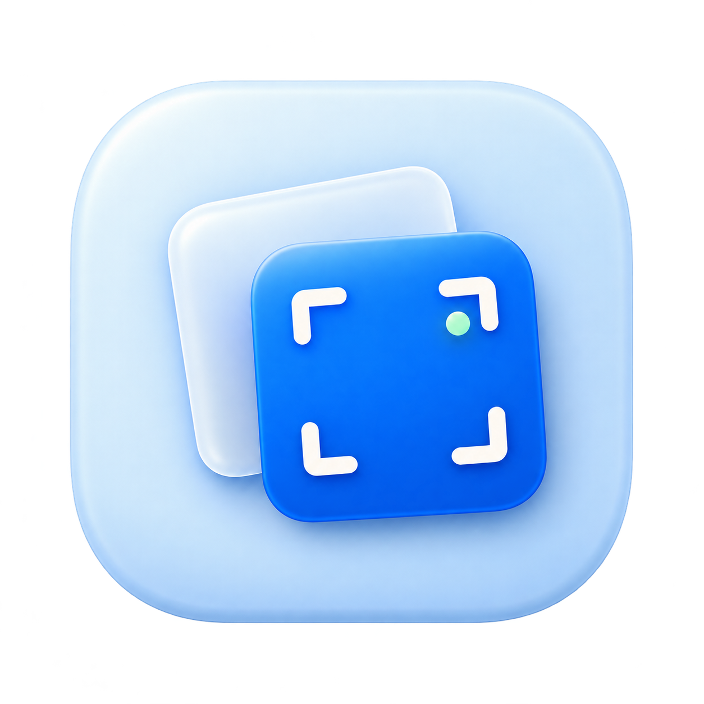

<p align="center">
  
</p>

<h1 align="center">Still</h1>
<p align="center">A local screenshot workspace for macOS. Capture, annotate, keep a few things handy, and find them again.</p>

Still is a native menu-bar app built with Swift, AppKit, and SwiftUI. It keeps a small queue of screenshots ready for drag and drop, an editable annotation canvas, and a searchable local history. No account, subscription, API key, or cloud service is required. An optional Raycast extension brings the same library to your launcher.

## Download

**[Download Still 1.1 Preview 2 for Mac (.dmg)](https://github.com/Niklex21/still/releases/download/v1.1.0-preview.2/Still-1.1.0-preview.2-universal.dmg)** · [Release notes](https://github.com/Niklex21/still/releases/tag/v1.1.0-preview.2)

Open the DMG, drag **Still** into **Applications**, then launch it. The app is self-contained; no developer tools or Node.js are needed. The universal download includes Apple Silicon and Intel code. If you use Preview 1, install this update from the DMG. Preview 2 includes **Check for Updates…** for future releases.

**First launch on macOS.** This preview is ad-hoc signed and unnotarized. If macOS shows “Still Not Opened,” click **Done**. If you trust this download, open **System Settings → Privacy & Security → Open Anyway** and confirm. On your first capture, allow **Still** under **Screen & System Audio Recording**, then reopen it if prompted. [Apple’s guide to opening downloaded apps](https://support.apple.com/en-us/102445)

[](https://github.com/Niklex21/still/actions/workflows/checks.yml) · [Security policy](SECURITY.md) · [Privacy and local data](docs/privacy.md) · [MIT license](LICENSE)

Prefer to inspect and compile it yourself? Follow [Build and install](#build-and-install); no prebuilt executable or install-from-the-internet script is required.

## What it does

- **Capture:** region, window, main screen, and live scrolling screenshots. Repeat the last region, delay a capture, or take a private region outside History. Center window captures on wallpaper or a customizable background.
- **Keep screenshots handy:** up to three current previews, with an older queue behind them. Drag images into another app, copy, edit, save, dismiss, or pin them above your windows.
- **Annotate without losing your edits:** arrows, shapes, freehand drawing, text, highlights, opaque redactions, numbered feedback pins, and reversible cropping. Saved marks stay editable. Zoom/pan, inspect at 100% pixels, and edit text inline.
- **Extract text:** recognize screenshot text locally, select words or a region, and copy any substring.
- **Find things again:** search names, OCR, visual descriptions, tags, notes, and source metadata. Filter by application, capture type, time, tags, favorites, queue, or whether text was detected.
- **Work with batches:** order screenshots, add step titles and captions, build walkthroughs, combine images vertically or side by side, or compare two images with an aligned reveal slider or highlighted differences, adjustable tolerance, and ignored areas.
- **Export:** PNG, JPEG, or HEIC with scale, maximum pixel width, and compression controls. Copy-for-sharing presets provide 1×, chat-ready, or a file under 2 MB. Destination apps can re-encode the pasted image. Walkthroughs export as a composite PNG, a PDF with one step per page, or Markdown with images.
- **Stay in your flow:** customizable shortcuts and hover actions, a movable shelf, floating pins, optional launch at login, and Raycast integration.

## Requirements

| Component | Requirement |
| --- | --- |
| App | macOS 14 or later |
| Building the full app | Xcode 27 SDK, including its command-line tools |
| Capture | Screen & System Audio Recording permission for Still |
| OCR | Apple's built-in Vision framework; no separate model or service |
| Semantic ranking | Apple's English sentence embedding model, when available |
| Generated image descriptions | macOS 27+, an eligible Apple Intelligence Mac, Apple Intelligence enabled, and the system vision model ready |
| Raycast extension | Raycast and Node.js; Node 24 recommended (22.22.2+ required by the extension build tools) |

The app checks model availability at runtime. Capture, annotation, history, OCR, and literal search remain usable without image descriptions. Semantic ranking falls back to literal results when the sentence model is unavailable.

## Build and install

To build the published preview from source, clone its release tag and build locally.

```sh
git clone --branch v1.1.0-preview.2 https://github.com/Niklex21/still.git
cd still
./scripts/build.sh
```

The script builds a release executable, assembles `dist/Still.app`, creates its icon sizes, includes the Raycast extension source, and signs the app ad hoc by default. Builds after 1.1 preview 1 bundle the pinned Sparkle updater. Its version and revision are recorded in Package.resolved.

In Finder, open `dist` and move **Still.app** to **Applications**, then launch it. Or inspect and run the local installer:

```sh
./scripts/install.sh
# Optional user-local destination:
# STILL_INSTALL_DIR="$HOME/Applications" ./scripts/install.sh
```

The installer builds locally, verifies the bundle, and installs it without launching it. When replacing a local Apple Development build, it reuses the same identity and checks its signing requirement before swapping the app. Quit an existing Still process first. It does not download or run a prebuilt app, use sudo, or disable macOS security controls.

 Install at `/Applications/Still.app` if you want Raycast semantic search: the extension invokes the app's executable there.

For a stable local signing identity:

```sh
STILL_SIGNING_IDENTITY="Your signing identity" ./scripts/build.sh
```

Keep the same identity across rebuilds where possible. A changed signature can cause macOS to request screen-capture access again. The source build uses a fixed app identifier so normal rebuilds share preferences and library state; signing and notarization for redistribution are separate steps.

### First launch

1. Find Still's icon in the menu bar and choose a capture mode.
2. Allow Still under **System Settings → Privacy & Security → Screen & System Audio Recording**. Reopen it if macOS requests that.
3. Open **Settings → Shortcuts** to choose your keys. If another app owns a shortcut, release it there first; Still reports registration conflicts.
4. Review **Launch at login** in Settings. Still attempts to enable it on its first normal launch.

In build 10, **Quick Start** appears the first time you open Still. Press **Done**, Return, or Esc to dismiss it. Reopen it anytime in **Help → Quick Start** to see your active shortcuts. **Help → Report a Bug…** opens an editable GitHub issue with the app and macOS versions. **Check for Updates…** looks for signed Still releases and offers to install an available update.

Closing a window leaves the menu-bar app running. **⌘Q closes Still's windows**; **Quit Still** in its menu stops the app and its shortcuts. A login launch starts in the background.

## The screenshot workflow

### Queue, shelf, and History

A new capture appears in the floating shelf. Up to three captures from the current batch have separate previews; older queued captures form an offset stack. Drag the shelf's empty space or expanded top bar to move it. Hover or click the older stack to expand it, or use the shelf shortcut.

While hovering, **⌘Delete** dismisses the preview and keeps it in History. Starting with build 7, **⌥⌘Delete** immediately moves the hovered screenshot and its original to macOS Trash. You can change both shortcuts in Settings.

Build 8 shows shortcut hints on the hover buttons. Hold **Option** to see matching alternate actions, then click the button or press its displayed shortcut. Dismiss becomes Trash and Copy for Sharing becomes Copy Full-Size Image with the default bindings. In History, the outlined trash can asks for confirmation; the filled red can skips it. Build 9 also pairs Pin with Prepare for Upload and Annotate with Copy Text. Release Option to switch back.

Hovering a preview dims its image and reveals corner actions. Configure their positions, size, dimming, and date visibility in **Settings → Controls**.

- A successful drag into another app removes the image from the queue and keeps it in History. A canceled drag keeps it queued.
- Copying, exporting, editing, or pinning also consumes its queue entry. Older images do not move into newly empty preview slots.
- Closing the shelf dismisses the **entire pending queue**, including its older stack. Those images remain in History and do not return with the next capture.
- Viewing an image clears its unread count without necessarily consuming it. The counter reflects queued images still waiting for attention.
- Automatic previews collapse when you move away and hide once nothing remains unread. A shelf opened explicitly stays open until you dismiss it. The side chevron opens History explicitly; hovering the older stack expands only the pending queue.
- In History, **Move to Trash** deletes the capture's stored image files, rather than just removing its preview.

The queue starts at the bottom left. **Pin to Screen** creates a separate floating image at the bottom right; additional pins overlap in a diagonal stack. Both remember moved positions. Drag a pin to move it, Option-drag to export it, and resize from a corner. Pins survive app restarts.

### Live scrolling capture

Press **⌥⇧4**, select the content area, then scroll downward. A click-through outline marks the selected area while a small movable preview beside it grows with the stitched image. The preview is excluded from the capture; it stays visible without flashing. Press the scrolling shortcut again or click the checkmark to finish. The × cancels. If a scroll jumps beyond the available overlap, move back slightly and continue more slowly.

Normal area captures use the frozen screen shown during selection, so switching apps immediately afterward cannot change their pixels. There are no intentional waits before normal capture. Encoding and thumbnail preparation happen in the background; only Delayed Capture uses a countdown.

### Repeat, delay, sharing, and privacy

The menu bar includes **Repeat Last Region**, **Delayed Region**, and **Private Region**. Assign any of them a shortcut in Settings. Repeating validates the previous region against connected displays; if it is no longer available, select a new region. Set the delay to 3, 5, or 10 seconds in General; the small countdown has a cancel button.

**Copy for Sharing** is available in screenshot actions and can be assigned a hover shortcut or corner. Choose the preset in Settings → Controls. Screen size uses the capture's display scale when known, otherwise preserves pixels. The under-2-MB preset creates a resized JPEG; the original remains intact.

**Settings → Privacy** offers private captures and optional history retention. Retention is off by default and protects queued captures, favorites, pins, and saved walkthrough sources. Private captures use temporary files for drag and drop and are excluded from indexing/history. Read [data handling and redaction limitations](docs/privacy.md).

### Default shortcuts

All of these can be changed or disabled in **Settings → Shortcuts**. Defaults apply to fresh settings; upgrades preserve custom bindings.

| Action | Default |
| --- | --- |
| Region capture | ⌥⇧1 |
| Window capture | ⌥⇧2 |
| Main-screen capture | ⌥⇧3 |
| Scrolling capture | ⌥⇧4 |
| Toggle shelf | ⌥⇧0 |
| Search History | ⌘F in Still; a global shortcut can be assigned |
| Import / paste an image | ⌘O / ⌘V in Still |

While hovering a screenshot (build 9 defaults):

| Action | Default |
| --- | --- |
| Copy for Sharing / original image | ⌘C / ⌥⌘C |
| Copy recognized text | ⌥⌘E |
| Annotate / pin or unpin | ⌘E / ⌘P |
| Export / prepare for upload | ⌘S / ⌥⌘P |
| Show description / reveal in Finder | ⌘I / ⌘R |
| Mark viewed / remove from queue | ⌘K / ⌘⌫ |

In History, the remove action asks to move the capture to Trash. Hover shortcuts release when an editing window opens, so its normal keyboard commands can take over.

### Editable markup and text

Double-click a screenshot or choose **Annotate**. Choose **Select** to move or resize existing marks; double-click text or a numbered pin to edit its label. Delete removes the selected mark. Hold Shift while drawing or resizing a figure for a square or perfect circle.

Use **⌘S** to save and **⌘Z / ⇧⌘Z** to undo or redo. A crop changes the exported extent while retaining the base image and annotations; **Reset Crop** restores that extent. **Revert Original** resets the editing session to the original capture. Previously flattened edits cannot be reconstructed as separate marks.

Choose **Select Text** to recognize the rendered image. Click a word or drag over words to collect text. The sidebar allows ordinary text selection, including copying only part of a line.

The eye-slash button suggests redactions for common email addresses, SSNs, long card-number patterns, and secret/token patterns. Review individual suggestions or apply all. These are heuristics and can miss sensitive content. Accepted redactions produce opaque masks in rendered exports. **Originals and editable bases remain in the local library**; redaction does not erase those source files.

### Scrolling capture and window backgrounds

For a scrolling screenshot, select the moving content and scroll slowly downward. Keep roughly a third of the preceding content visible between frames. Finish saves the stitched image; Cancel discards the session. Large fixed headers, repeated patterns, animation, and changing layouts can prevent a reliable match. Still rejects unmatched frames rather than silently joining them.

Window captures are centered on your wallpaper by default. **Settings → Background** offers wallpaper, a gradient, a solid color, a custom image, or transparency, with padding, shadow, and dimming controls.

### History and local search

**Smart Search** combines exact matches with local sentence-vector similarity over image descriptions, OCR chunks, and metadata. Turn it off for literal matching. The current semantic model is English; literal matching is still useful for other languages.

**Show Description** displays the stored image summary and visual tags. Add personal tags, notes, or a source URL there. New captures record the frontmost application's identity and available window title; Still does not infer a website URL from pixels.

On supported Macs, image analysis runs one capture at a time in the background. **Settings → Search** shows availability and progress, and lets you pause or retry it. Descriptions can be imperfect or refused by the system model. Saving an edit invalidates old OCR and descriptions, then indexes the new rendered pixels. Late results cannot overwrite a newer revision or restore a deleted image.

### Walkthroughs and comparison

In History, choose **Select**, select up to 50 screenshots, then **Create Walkthrough**. Reorder steps with the arrow buttons and add titles or captions. Choose **Walkthrough**, **Vertical**, or **Side by Side**. Two selected images also offer **Compare**, with an interactive reveal slider.

Save the editable project and reopen it from History's numbered-list menu. PNG exports combine the images; PDF exports put one step on each page; Markdown exports create a new folder containing the document and rendered images. The interactive Compare view is for inspecting two images; use Side by Side for a combined image export.

Composite images and captures have a 30,000-pixel dimension limit and a 150-megapixel allocation limit. Use a multipage PDF instead of an enormous composite when appropriate.

### Export and upload dialogs

**Export / Resize** controls format, percentage scale, maximum pixel width, and compressed-format quality. A maximum width of **0** uses the chosen scale without a width cap. Aspect ratio stays locked. JPEG composites transparent pixels on white.

For websites that only accept an Upload button, **Prepare for Upload** copies a file path. In the macOS file chooser, press **⌘⇧G**, paste the path with **⌘V**, and press Return. The corner helper uses the current PNG; the export window can first generate a resized or compressed copy. Neither action uploads a file automatically.

## Raycast

From the repository root:

```sh
cd Raycast
npm ci
npm run dev
```

Alternatively, use Raycast's **Import Extension** command and select the `Raycast` directory. Install Still at `/Applications/Still.app` before using semantic search.

Available commands:

- **Search Screenshots:** preview images, search text and meaning, filter results, copy images or OCR, annotate, select text, export, inspect descriptions, reveal files, and add items to the shelf.
- **Capture Screenshot:** start a region capture.
- **Capture Scrolling Screenshot:** select a scrolling region.
- **Show Screenshot Shelf:** open the shelf explicitly.

The extension reads the local index, refreshes it every two seconds, and calls Still's read-only search command for semantic ranking. Actions that change library state go through `still://` commands, so Raycast never races the app by writing the index itself. No paid Raycast plan is required for these extension commands.

## Local data and privacy

Still stores its library at:

```text
~/Library/Application Support/Still/
├── library.json   # captures, queue state, metadata, descriptions, editable documents
├── Images/        # rendered PNGs, originals, and editable base images
├── Exports/       # resized/compressed copies prepared for upload
└── Walkthroughs/  # editable batch projects
```

Back up the entire directory together. User preferences, shortcuts, and remembered panel positions are managed separately by macOS preferences.

OCR, sentence embeddings, and image description generation run locally through Apple frameworks. The app has no cloud upload fallback or screenshot-sharing service. Opening a source URL, exporting a file, or dropping an image into another application is an explicit user action; that destination has its own data handling.

## Development and testing

Run core tests:

```sh
CLANG_MODULE_CACHE_PATH="$PWD/.build/module-cache" \
SWIFTPM_MODULECACHE_OVERRIDE="$PWD/.build/module-cache" \
swift test --disable-sandbox --cache-path "$PWD/.build/cache"
```

After building the app, run native integration checks from a logged-in macOS desktop session:

```sh
dist/Still.app/Contents/MacOS/Still --self-test
dist/Still.app/Contents/MacOS/Still --visual-search-self-test
```

The native suite uses temporary libraries and restores the clipboard. It exercises editable-document persistence and failed-save recovery, OCR geometry, redaction pixels, image formats, walkthrough/PDF rendering, queue behavior, pins, and shortcut registration. It also requires the system sentence embedding model. The visual pipeline suite uses a controlled analyzer to check edit/delete races, pause/resume, and retries.

To test the actual Apple Intelligence vision model on synthetic fixtures:

```sh
dist/Still.app/Contents/MacOS/Still --visual-model-test
```

That check requires an eligible Mac and a ready model. Do not treat a skipped or unavailable-model check as a successful model test. Native drag-and-drop tests require normal macOS file access; a restricted shell sandbox can prevent their temporary file representations from loading.

An isolated demo avoids importing fixtures into your real library:

```sh
STILL_DATA_DIR="$(mktemp -d /tmp/still-demo.XXXXXX)" \
  dist/Still.app/Contents/MacOS/Still --demo
```

Check the Raycast extension:

```sh
cd Raycast
npm ci
npm run typecheck
npm test
npm run build
```

To create a downloadable app or perform Developer ID signing and notarization, see [Release packaging](docs/releases.md).

See [Architecture](docs/architecture.md) for the source map, data model, and integration boundaries, and [Contributing](CONTRIBUTING.md) for change and validation guidance.

## Status and limitations

Still is an early macOS app with a downloadable universal preview and source builds. The preview is not notarized, and its first upgrade requires installing a new DMG. Scrolling stitching depends on visual overlap. AI descriptions and redaction suggestions need review. English semantic ranking and optional macOS 27 image understanding have the model requirements described above. There is no video/GIF recorder or cloud sharing backend.

## License

[MIT](LICENSE). The app icon's source and generation notes are in [Resources/Icon-notes.md](Resources/Icon-notes.md).

## Checks and release status

Run `./scripts/check.sh` to execute Swift tests, synthetic native workflows, visual-index pipeline checks, and Raycast tests/build/audit. The workflow tests use temporary libraries, a separate clipboard, and offscreen bitmap rendering. They do not take screenshots of your desktop. UI snapshots contain synthetic fixtures and are written to `.build/qa-snapshots`.

GitHub Actions repeats these checks on a separate Mac and assembles a universal DMG. CodeQL covers the optional Raycast JavaScript/TypeScript; the Swift app is not claimed to have a CodeQL audit. Dependencies are proposed for update by Dependabot. See [contributing](CONTRIBUTING.md), [security](SECURITY.md), and [the release QA matrix](docs/release-qa.md).

Automated checks do not validate macOS privacy prompts, first launch from a browser download, every drag destination, Intel execution, or real scrolling behavior. Those remain explicit manual release checks. No public preview is represented as notarized or independently audited.
